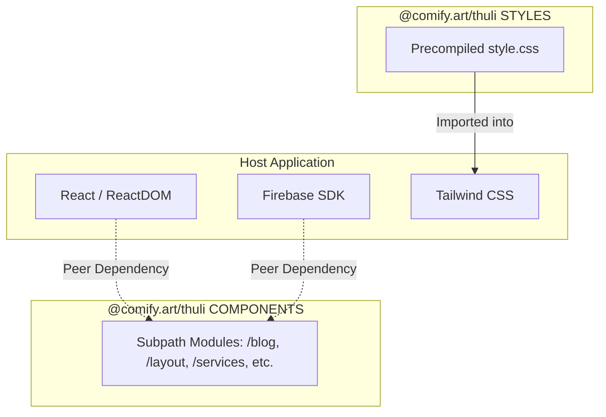

# Architecture & Design Standards

This document describes the architectural philosophy, dependency boundaries, security principles, and build pipeline for `@comify.art/thuli`.

---

## 1. Design Philosophy

1. **Host App Independence**: `@comify.art/thuli` does not maintain hardcoded configuration, singleton instances, or environment variables. All stateful services (such as Firebase auth or Firestore) are provided by the consuming application.
2. **First-Class Subpath Exports**: Each domain module is an independent entry point in the package `exports` map, preventing unnecessary bundle bloat.
3. **Open Standards**: Standardized under the **Apache-2.0** open-source license.
4. **Security & Privacy Hygiene**: The library guarantees zero leakage of internal infrastructure details, private paths, or developer-specific metadata.

---

## 2. Dependency Tiering

To prevent duplicate runtime copies of libraries (such as React or Firebase SDK instances), dependencies are structured as follows:

### Peer Dependencies
- `react`, `react-dom` (`>=18.0.0`)
- `react-router-dom` (`>=6.0.0`)
- `firebase` (`>=10.0.0`)
- `lucide-react` (`*`)
- `react-markdown`, `remark-gfm`, `remark-math`, `rehype-katex`, `katex`

### Direct Dependencies
- Limited strictly to runtime utility transforms (e.g. `remark-breaks`).

---

## 3. Style Architecture

- **Tailwind CSS v4**: Built natively on Tailwind v4 using `@theme` and `@custom-variant`.
- **CSS Distribution**: Styles are compiled and distributed as a standalone `style.css` in the package root.
- **Tree-Shaking Safety**: Declared with `"sideEffects": ["*.css"]` in `package.json` so bundlers safely prune unused JS modules while guaranteeing stylesheet inclusion when imported.

---

## 4. Build Pipeline

The package utilizes a multi-entry Vite library build pipeline:
1. **TypeScript & Bundler**: Vite compile runs with externalized peer dependencies and emits clean modern ES modules.
2. **Type Declarations**: `vite-plugin-dts` emits `.d.ts` declaration files mirroring each subpath entrypoint.
3. **CSS Compilation**: `@tailwindcss/cli` compiles `src/index.css` to `dist/style.css`.
4. **Package Tarball Verification**: Only `dist/`, `README.md`, and `LICENSE` are included in the published npm package.
